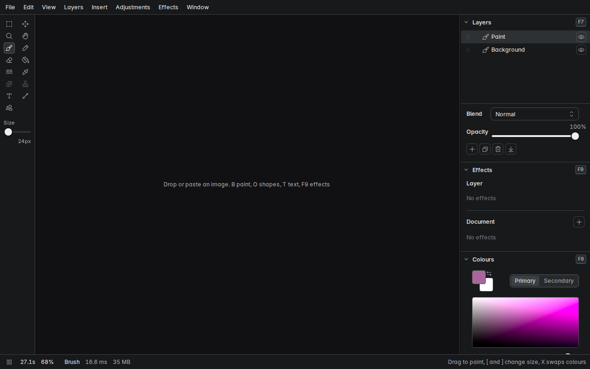

# gp-design

A compositing editor that runs in the browser on WebGPU, live at [design.gabrielpenman.com](https://design.gabrielpenman.com). It looks and works like paint.net, with layers, brushes, shapes, text and effects, but the pipeline underneath is float and OKLab, so blends and gradients don't band or go muddy. Everything is computed on the client. The small Python server only serves the build.



## Running it

You need Node 22 and a browser with WebGPU (recent Chrome or Edge).

```sh
npm install
npm run dev
```

`npm test` runs the unit tests. To serve a production build the way the live site does, run `npm run build` and then `python3 -m uvicorn server.main:app --port 8095` (it needs `fastapi` and `uvicorn`). `npm run e2e` builds and runs the Playwright suite against that server, so start it first on :8095, or set `GDESIGN_BASE_URL` to wherever a build is served.

## Licence

Copyright (C) 2026 Gabriel Penman. Licensed under the [GNU Affero General Public License v3.0 only](LICENSE). You can read it, run it, change it and share it for any purpose. If you share a changed copy, or run one as a network service, you must offer its source under the same licence. The UI fonts are under the SIL Open Font License, and their licence files are in `public/g/fonts`. The text layer's MSDF atlas is generated from JetBrains Mono, with its licence in `public/assets/msdf/jetbrains-mono`.

Required Notice: Copyright Gabriel Penman (https://gabrielpenman.com)
